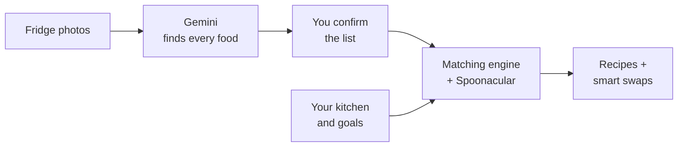
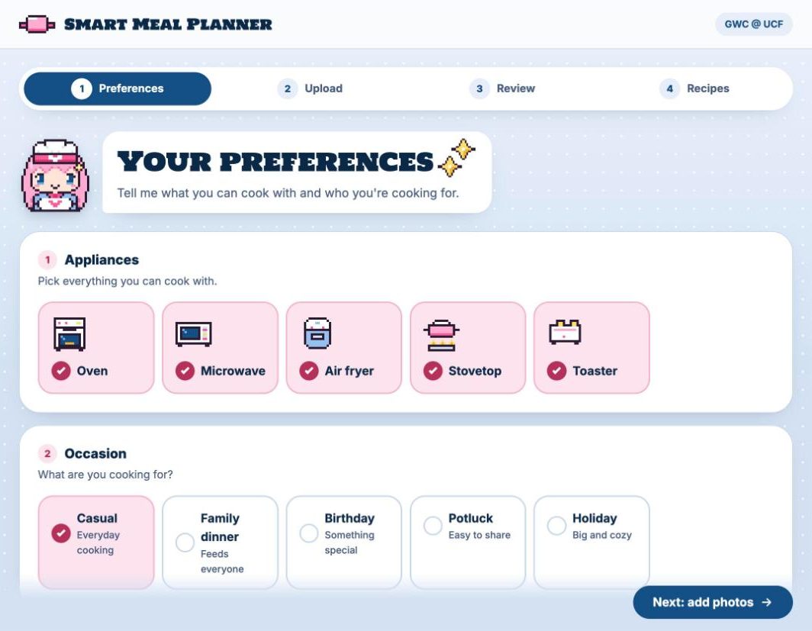
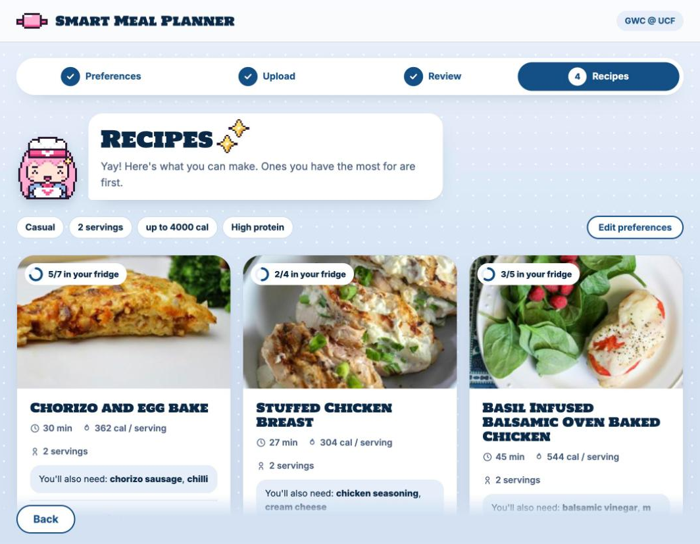

<div align="center">


# Smart Meal Planner

**Your fridge is already a recipe.** Snap a photo, and AI turns whatever you have into meals you can cook tonight.

</div>

## Overview

Every week, food goes bad in the fridge while we order takeout, because we can't see a meal in a few eggs, half a bag of spinach and some cheese. Recipe sites don't help. They start from a shopping list, not from what you own, and they don't know you only have a microwave, that you're cooking for a potluck, or that you're staying under 500 calories.

Smart Meal Planner flips it. **AI vision reads your fridge**, a **custom matching engine** works out which recipes you can actually make with your food, your kitchen and your goals, and **AI smart swaps** fill the gaps with what's already on your shelf. No typing out ingredients, no extra trip to the store.

## How it works

<table>
  <tr>
    <td width="64" align="center"></td>
    <td><b>AI photo detection.</b> Upload up to 5 photos of your fridge, pantry or groceries. Gemini identifies every food and draws a labeled bounding box around each one, right on your photo. If the main model is overloaded, the backend falls back to a second model automatically.</td>
  </tr>
  <tr>
    <td align="center"></td>
    <td><b>You stay in control.</b> Tap any box to drop a wrong guess, or type in what the camera missed. The photo and the list stay in sync.</td>
  </tr>
  <tr>
    <td align="center"></td>
    <td><b>Built around your kitchen.</b> Tell it your appliances (oven, microwave, air fryer, stovetop, toaster), the occasion (casual, family dinner, birthday, potluck, holiday), servings, a calorie cap per serving, and high-protein or low-sugar goals. Recipes that need an oven you don't have never show up.</td>
  </tr>
  <tr>
    <td align="center"></td>
    <td><b>A matching engine that thinks like a cook.</b> Spoonacular supplies candidate recipes. Our backend then decides what you actually have: "cherry tomatoes" count as tomato, your "chicken breast" covers a recipe's "chicken", but "chicken broth" doesn't, and basics like salt, oil and flour are assumed. Recipes are ranked by fewest missing ingredients, then by how many of <i>your</i> foods they use, then by speed, with every amount scaled to your servings.</td>
  </tr>
  <tr>
    <td align="center"></td>
    <td><b>AI smart swaps.</b> Missing one ingredient? Gemini suggests a substitute from the foods you already have ("No sour cream? Use your Greek yogurt"), checked by the backend so it can only recommend something that's really in your fridge.</td>
  </tr>
</table>



<table>
  <tr>
    <td width="50%"><br><sub><b>Your kitchen.</b> Appliances, occasion and goals.</sub></td>
    <td width="50%"><br><sub><b>Recipes.</b> How much you already have, and what you'd still need.</sub></td>
  </tr>
</table>

## Under the hood

- **Fast and cheap by design:** photos are compressed in the browser before upload, a single recipe search returns everything needed, and repeat searches are cached, so changing servings or appliances costs nothing.
- **Never a dead end:** if photo detection fails, you can keep going by adding foods by hand, and every error is a friendly message.
- **Built to run in public:** daily usage caps, upload checks before anything reaches the AI, and API keys that never leave the server.
- **Tested:** 51 automated checks cover the ingredient-matching rules.
- **For everyone:** keyboard and screen-reader friendly, works on phones, and respects reduced-motion settings.

## Tech stack

| | |
| --- | --- |
| Frontend | HTML, CSS, JavaScript, Vite |
| Backend | Python, FastAPI |
| AI | Google Gemini (photo detection and smart swaps) |
| Recipe data | Spoonacular API |

## Getting started

Needs Python 3.10+ and Node.js 20+. API keys are optional: leave them blank to use the built-in sample data.

```bash
# Backend: http://localhost:8000
cd backend
python3 -m venv venv && source venv/bin/activate      # Windows: venv\Scripts\activate
pip install -r requirements.txt
cp .env.example .env                                  # add SPOONACULAR_API_KEY and GEMINI_API_KEY, or leave blank
uvicorn main:app --reload

# Frontend: http://localhost:5173
cd frontend
npm install
cp .env.example .env
npm run dev
```

Tests: `cd backend && python test_matching.py`

| Part | Path |
| --- | --- |
| Step-by-step app | `frontend/src/wizard.js`, `frontend/src/steps/` |
| Mascot and pixel art | `frontend/src/assets/pixel/` |
| AI detection, matching engine, ranking, swaps | `backend/main.py` |
| Sample data | `backend/sample_data/` |

## Team

| | Role | What they built |
| --- | --- | --- |
| **Jesica Bermudes** | Tech lead · Backend | AI photo detection, matching engine and ranking, smart swaps, deployment |
| **Rhea Jacob** | Frontend · App flow | Step-by-step app, photo upload and review screens, recipe cards, backend connection |
| **Adiam Teka** | Frontend · Design | Figma screen designs, the shared style system (colors, fonts, buttons, cards, phone-friendly layout), preferences page with input checks and saved settings |

<div align="center">
<br>
<br>
<sub>Built for the Girls Who Code Projects Program, Fall 2026.</sub>
</div>
